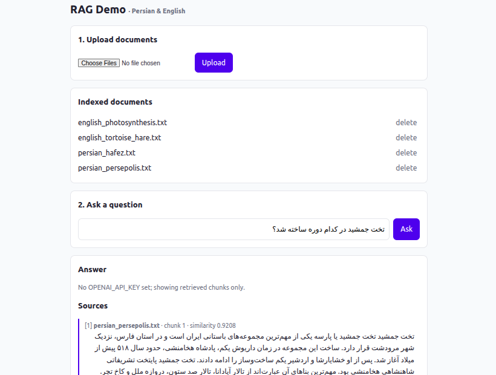
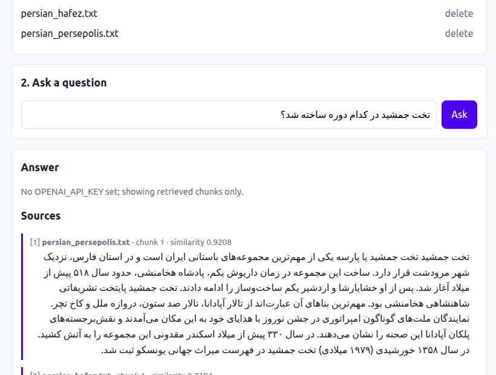
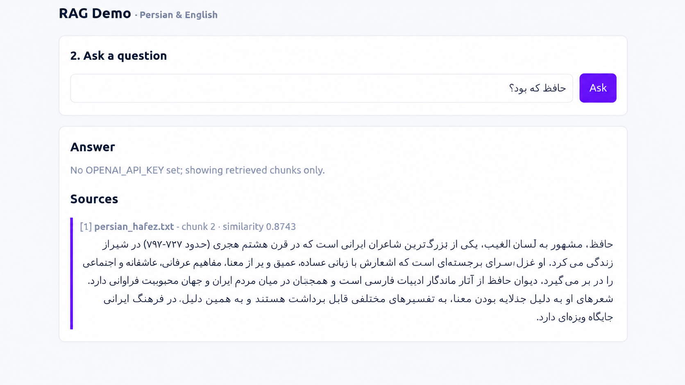
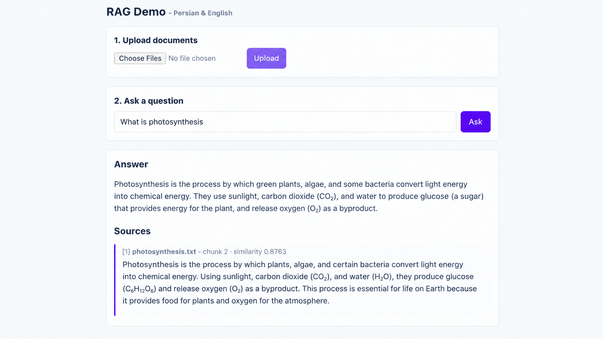
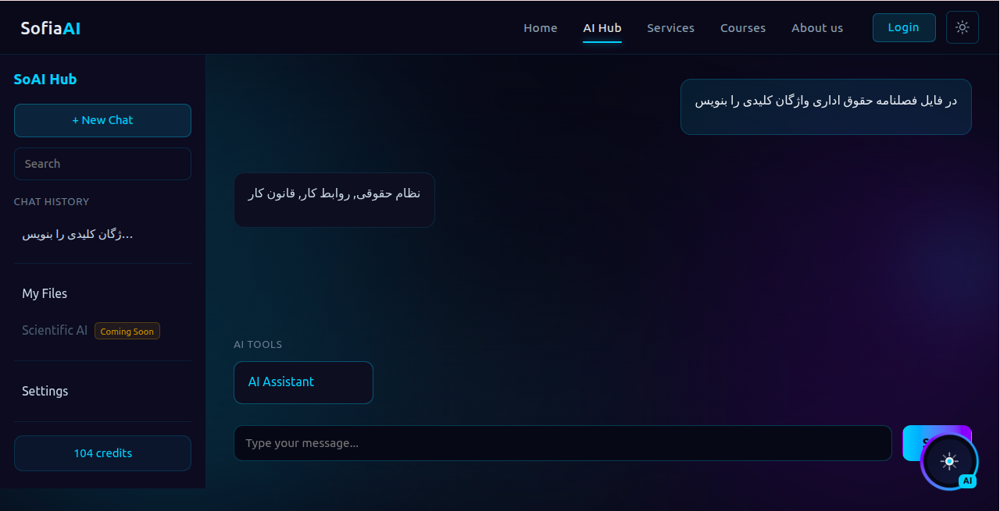
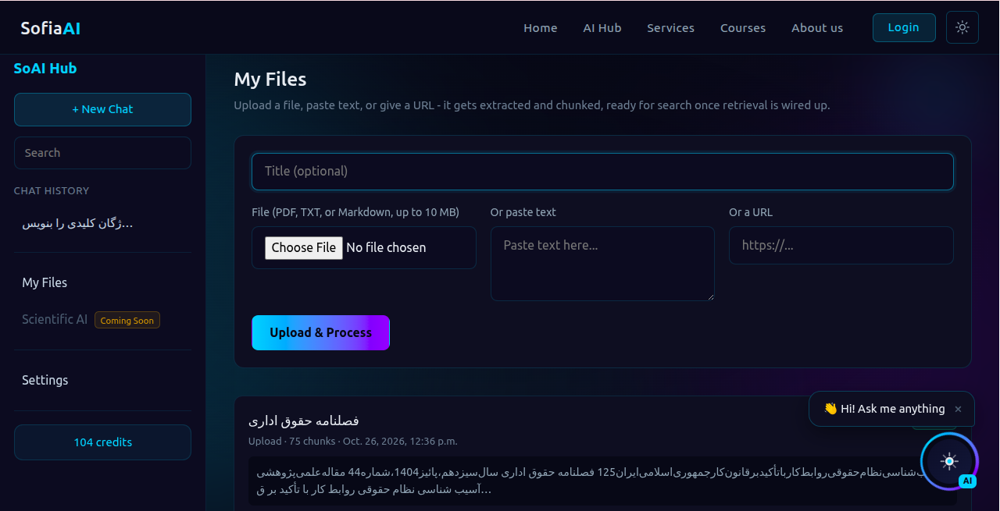

# Persian/English RAG demo

A small educational RAG app: Django 5, PostgreSQL + pgvector, local `intfloat/multilingual-e5-small` embeddings.

## Demo screenshots






## Product screenshots (SoAI Hub, private)




## Run

```bash
docker compose up --build        # first start downloads the ~470 MB embedding model
```

Open <http://localhost:8000>. The three files in `sample_docs/` are indexed on startup.
To use an LLM, copy `.env.example` to `.env` and set `OPENAI_API_KEY` (and `OPENAI_BASE_URL` / `OPENAI_MODEL` for any
OpenAI-compatible server). Without a key you get the retrieved chunks only.

```bash
curl -s localhost:8000/api/ask -H 'Content-Type: application/json' \
     -d '{"question": "تخت جمشید را چه کسی ساخت؟"}'
```

Response: `{"question", "answer" (null without a key), "note", "sources": [{"document", "chunk", "text", "score"}]}`.

## How it works

| Step | Where |
|------|-------|
| Extract text (.txt/.pdf/.docx) | `rag/ingest.py` |
| Fixed-size chunking with overlap | `rag/chunking.py` |
| Embed with `passage:` / `query:` prefixes | `rag/embeddings.py` |
| Cosine top-k via pgvector | `rag/retrieval.py` |
| Answer with one short system prompt | `rag/llm.py` |

## Tests

Tests need a PostgreSQL with the pgvector extension and use a fake embedder (no model download).

```bash
pip install -r requirements-dev.txt       # app + pytest, no torch
POSTGRES_HOST=localhost pytest                # any local Postgres with pgvector, user/password/db "rag"
pip install -r requirements-model.txt   # only for the optional real-model test
RUN_MODEL_TESTS=1 pytest tests/test_real_model.py   # optional, real model
```

## Non-goals

No auth, multi-tenancy, reranking, hybrid search or index tuning. Search is an exact scan, which is fine for a demo.

## GitHub Codespaces

Open the repo in a Codespace (Docker-in-Docker is configured), run `docker compose up --build`, and open the forwarded port 8000.

Screenshots and the SoAI Hub name are © Sofia AI, all rights reserved. The MIT license applies to the demo code only.
